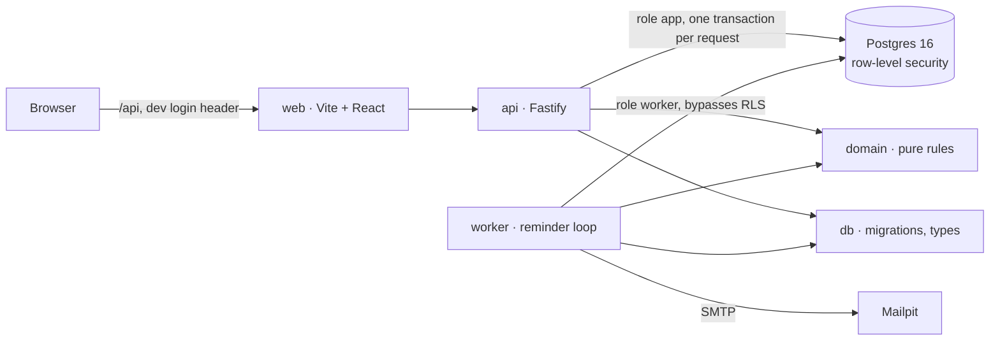

# Renewal tracker

A small multi-tenant service that tracks software subscriptions for an organisation and sends a reminder before each one renews. It exists to show how I run a backend project: branches and pull requests, tests against a real database, tenant isolation enforced by the database, and a reminder job that is safe to run twice. It is not a product.

## Run it

You need Docker. Nothing else.

```
git clone https://github.com/jbaze/renewal-tracker.git
cd renewal-tracker
docker compose up
```

That starts Postgres, applies the migrations, loads two example organisations, and brings up the API, the reminder worker, the web app and Mailpit.

| What             | Where                                   |
| ---------------- | --------------------------------------- |
| Web app          | http://localhost:5173                   |
| API              | http://localhost:3000                   |
| Mailpit (emails) | http://localhost:8025                   |
| Postgres         | localhost:5432, `postgres` / `postgres` |

If a port is taken, set `WEB_PORT`, `API_PORT`, `POSTGRES_PORT` or `MAILPIT_PORT` in a `.env` file first (see `.env.example`).

**Signing in.** There is no real authentication; it is out of scope. The web app has a select of seeded users, and the API reads the user from an `x-user-email` header. Pick `owner@acme.test` to write, `member@acme.test` to see the read-only view, or `owner@northwind.test` for the other organisation. `member@acme.test` belongs to both, which is how you try the organisation switcher.

**Seeing a reminder.** The worker runs every 30 seconds in compose. The seed includes a subscription that renews tomorrow, so within a minute a reminder for it lands in Mailpit.

### Working on it without Docker for the apps

```
docker compose up postgres mailpit   # database and mail only
cp .env.example .env
pnpm install
pnpm db:migrate && pnpm db:seed
pnpm --filter @renewal/api dev       # http://localhost:3000
pnpm --filter @renewal/worker dev
pnpm --filter @renewal/web dev       # http://localhost:5173
pnpm check                           # lint, prettier, typecheck, tests, same as CI
```

Node 22 and pnpm 12 (`corepack enable` gets you pnpm).

## What is in the box



| Package           | What it is                                                                                                          |
| ----------------- | ------------------------------------------------------------------------------------------------------------------- |
| `packages/domain` | Pure functions: money, renewal dates (month ends, leap years), reminder schedule in the organisation's timezone.    |
| `packages/db`     | Plain SQL migrations with a small runner, Kysely table types written by hand, the seed, tenant transaction helpers. |
| `apps/api`        | Fastify. A plugin resolves the user and organisation and opens the request transaction; routes validate with Zod.   |
| `apps/worker`     | The reminder loop: claim due rows, log, send, set the next reminder; roll renewals that have passed.                |
| `apps/web`        | React with plain CSS: list, add and edit, cancel, upcoming renewals in 30/60/90 days, monthly total per currency.   |

### The three decisions worth reading

- [ADR-001: Data model](docs/adr/001-data-model.md). Integer cents plus a currency code, `org_id` on every tenant table, a unique key so the reminder log cannot hold a duplicate.
- [ADR-002: Row-level security](docs/adr/002-row-level-security.md). Why the database enforces tenant isolation rather than a `WHERE` clause in every query, and the two explicit exceptions.
- [ADR-003: The reminder job](docs/adr/003-reminder-job.md). `FOR UPDATE SKIP LOCKED`, log before send, one transaction per row, why the worker is allowed to see every organisation, and why delivery is at-least-once rather than exactly-once.

### How the repository is run

`CONTRIBUTING.md` has the branch and commit rules. In short: `main` only changes from `dev` through a pull request, `dev` only changes from a branch per issue through a pull request, every pull request has a linked issue, the four-heading template and a green `ci` check (lint, prettier, typecheck, migrations up and down, tests against Postgres). Squash merges keep the history one line per change. Where a diff needed a decision, the pull request has a review comment explaining it.

## Tests

```
pnpm test
```

| Suite             | What it proves                                                                                                                                                       |
| ----------------- | -------------------------------------------------------------------------------------------------------------------------------------------------------------------- |
| `packages/domain` | Month-end and leap-year renewals, yearly cycles, roll-forward of past dates, cancelling versus cancelled, the 30/7/1 schedule across a DST change, next reminder.    |
| `packages/db`     | Migrations apply, roll back and apply again. As the `app` role: a query with no `WHERE` sees one organisation; reads, updates and inserts across organisations fail. |
| `apps/api`        | Login header, organisation switching and refusal, no leaked transactions, validation errors per field, role checks, pagination and filters, cross-tenant 404s.       |
| `apps/worker`     | Run twice sends once; two workers in parallel send once; a failed send rolls back and retries; renewals roll forward; cancelling becomes cancelled.                  |
| `apps/web`        | The form: required fields, the exact payload in cents, edit mode.                                                                                                    |

The database suites run against a real Postgres, locally from `docker compose` and in CI from a service container. There are no mocks of the database.

## Out of scope

Listed so nobody has to guess:

- Real authentication and authorisation beyond the three roles. The dev login stands in for an identity provider; `resolve_user_id` in migration 0002 is the one function that would be deleted with it.
- Billing, seats, invoices, currency conversion.
- Deployment, secrets management, monitoring. The compose file is for a laptop.
- Right-to-left layout and translations. The UI is English only.
- Design. The web app is readable, not designed.
- Catching up every missed reminder after a long outage; the worker sends the most recent one per subscription.

## How AI is used here

An AI coding assistant was used in this repository the way I use it on client work: for scaffolding, tooling, CRUD routes, the UI and first drafts of tests. Every change was reviewed and edited before it was committed, the pull requests carry the reasoning, and the database policies, renewal rules and reminder job are covered by tests that exercise them against a real Postgres rather than taken on trust.

## What I would do next

1. Replace the dev login with an identity provider and take the user id from its token.
2. Move `next_reminder_at` maintenance into a database trigger so no code path can forget it.
3. A per-organisation reminder hour and per-subscription recipients.
4. A catch-up policy for reminders missed during an outage, decided with the product owner rather than by the code.
5. Per-package test databases so the suites can run in parallel again.
